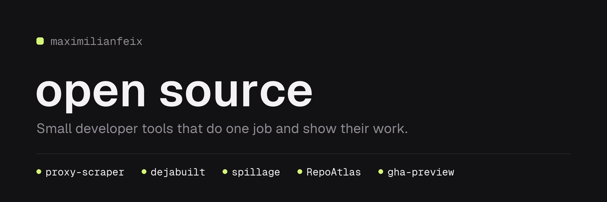

# communitybot

The Discord bot of the [maximilianfeix](https://github.com/maximilianfeix) open-source server. It keeps the
server laid out, shows every project with its stars and latest release, and announces new releases.



## What it does

- **Lays out the server from code.** Roles, categories, channels, topics and read-only permissions are
  described in [`definition.py`](communitybot/definition.py). On every start the bot compares that with
  the server and fixes the difference. It changes only what it created itself, and it never deletes.
- **Keeps three messages current** in `#welcome`: a welcome with the rules, one card per project (stars,
  latest release), and the buttons for release notifications.
- **Announces releases** in `#announcements`, once each, with the notes cleaned up and shortened. Members
  who pressed a project's button are pinged; nobody else is.
- **Answers two commands:** `/projects` and `/project <name>`. Only the person asking sees the answer.

It does not read messages, does not know who is on the server and asks for no privileged intent.

## How it is built

| Module | Job |
| --- | --- |
| `projects.py` | The list of projects. Adding one adds its card, role and announcements. |
| `definition.py` | What the server should look like. |
| `plan.py` | Pure: definition plus what exists gives a list of operations. |
| `layout.py` | Reads the server, applies the operations, keeps the bot's messages. |
| `github.py` | Reads stars and releases from the GitHub API, with ETags. |
| `releases.py` | Pure: which releases are new. |
| `sanitize.py` | Pure: makes text from GitHub safe to post. |
| `messages.py` | Every embed the bot posts. |
| `views.py` | The notification buttons. They survive restarts. |
| `state.py` | One JSON file: what the bot created and what it already announced. |
| `bot.py` | The client that ties it together. |

Decisions worth knowing:

- **Ownership by id.** The bot remembers the id of everything it creates. A channel that merely has the
  right name belongs to someone else: the bot logs a conflict and leaves it alone. This is also how it
  stays out of the way of other bots on the server.
- **First look is a baseline.** The first time the bot sees a repository it remembers the existing
  releases and announces nothing.
- **Remember, then post.** A release is marked as announced before the message is sent. After a crash in
  between, one announcement is missed rather than sent twice.
- **No pings by default.** The client is created with every mention switched off. Only the release
  announcement allows one thing: the role of that project.
- **GitHub text is untrusted.** Release notes lose HTML, hidden links, invite links and anything that
  could ping, and are cut to 1,500 characters.

## Run it locally

Python 3.10 or newer.

```bash
python -m venv .venv
.venv/bin/pip install --require-hashes -r requirements-dev.txt   # .venv\Scripts\pip on Windows

DISCORD_TOKEN=... COMMUNITYBOT_GUILD_ID=... .venv/bin/python -m communitybot
```

| Variable | Default | |
| --- | --- | --- |
| `DISCORD_TOKEN` | required | the bot token |
| `COMMUNITYBOT_GUILD_ID` | required | id of the one server the bot works in |
| `GITHUB_TOKEN` | none | optional; raises GitHub's limit from 60 to 5,000 requests an hour |
| `COMMUNITYBOT_STATE` | `state.json` | where the state file lives |
| `COMMUNITYBOT_POLL_SECONDS` | `900` | how often to look at GitHub; at least 300 |

Without a GitHub token the bot makes 10 requests per round, 40 an hour at the default interval.

Checks:

```bash
ruff check . && ruff format --check . && mypy && pytest
```

The tests use no network and no real Discord connection.

## Set it up for a server

1. **Create the application** at <https://discord.com/developers/applications>: *New Application*, then
   *Bot*, then *Reset Token*. Switch **Public Bot** off. No privileged intents are needed.
2. **Invite it** (replace `APPLICATION_ID`):

   ```
   https://discord.com/oauth2/authorize?client_id=APPLICATION_ID&scope=bot+applications.commands&permissions=268561424
   ```

   That number is: view channels, send messages, embed links, attach files, read message history, manage
   messages, manage channels and manage roles. Not administrator.
3. **Add the repository secrets** (*Settings → Secrets and variables → Actions*):

   | Secret | |
   | --- | --- |
   | `DISCORD_TOKEN` | the bot token |
   | `GUILD_ID` | the server's id |
   | `DEPLOY_HOST` | IP or host name of the server |
   | `DEPLOY_SSH_KEY` | private key for the deploy login |
   | `DEPLOY_KNOWN_HOSTS` | output of `ssh-keyscan -t ed25519 <host>` |
   | `DEPLOY_USER` | optional: a user with passwordless `sudo`, if `root` may not log in |
   | `GH_API_TOKEN` | optional: a read-only GitHub token for the higher rate limit |

4. **Deploy.** Every push to `main` runs [`ci.yml`](.github/workflows/ci.yml): lint, types and tests, then
   the code goes to `/opt/communitybot/app`, the secrets to `/etc/communitybot.env` (root only), and
   [`deploy/install.sh`](deploy/install.sh) sets up a system user, a virtual environment with
   hash-checked packages and a locked-down systemd service. *Run workflow* redeploys by hand.

On the server:

```bash
systemctl status communitybot
journalctl -u communitybot -f
```

## Change the server

Edit [`definition.py`](communitybot/definition.py) or [`projects.py`](communitybot/projects.py), open a
pull request, merge. The next deploy applies it. Removing something from the definition leaves it on the
server; delete it there by hand.

The banner is drawn by [`tools/make_banner.py`](tools/make_banner.py) and committed.

## Licence

MIT. See [LICENSE](LICENSE). Security problems: see [SECURITY.md](SECURITY.md).
